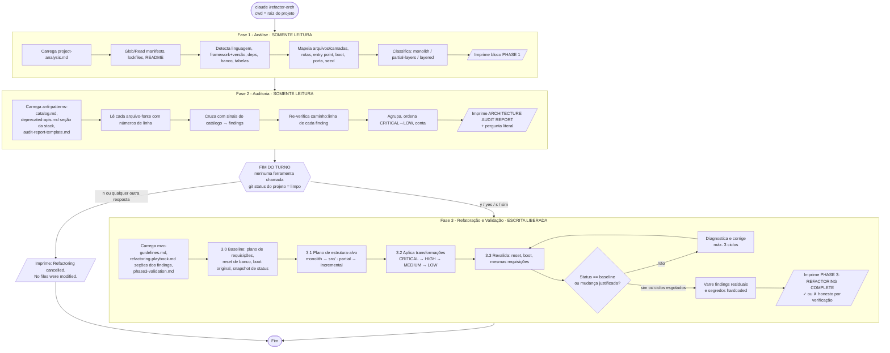

# ARCHITECTURE — Skill `refactor-arch`

> Derivado de `SPEC.md` (fonte única da verdade) e `docs/user-stories.md`. Enunciado original: `docs/CHALLENGE.md`.
> Escopo deste documento: design da skill, fluxo das 3 fases, estratégia de agnosticismo, catálogo/playbook mínimos, validação, decisões (ADRs) e plano de trabalho dos próximos agentes.
> Localização: `docs/ARCHITECTURE.md` (definida pelo orquestrador). A SPEC §8 cita `ARCHITECTURE.md` na raiz — documentos derivados (README Seção B) devem apontar para `docs/ARCHITECTURE.md`.
> Nenhum código de produção aqui; trechos são pseudocódigo/ilustrativos.

---

## 0. Resumo executivo

| Tema | Decisão |
|---|---|
| Estrutura da skill | `SKILL.md` enxuto (orquestrador) + **7 arquivos de referência** planos no diretório da skill (5 áreas obrigatórias + `deprecated-apis.md` + `phase3-validation.md`) — ADR-07 |
| Pausa obrigatória | Fases 1–2 somente leitura; após o relatório a skill imprime a pergunta literal e **encerra o turno sem nenhuma chamada de ferramenta** — ADR-01 |
| Execução automatizada | Duas invocações headless na mesma sessão (`claude -p "/refactor-arch"` → `claude -p --continue "y"`), com `git status` limpo registrado entre elas — ADR-01 |
| Relatório em `reports/` | A skill **só imprime**; o operador extrai o bloco e grava `reports/audit-project-N.md` (fora do projeto) — ADR-02 |
| Endpoints admin inseguros | Rota continua registrada, protegida por `ADMIN_TOKEN` (403 sem token válido; comportamento original com token) — ADR-03 |
| Validação Fase 3 | Baseline capturada **depois do "y" e antes da primeira edição**; boot real pelo comando documentado; requisições HTTP com o runtime do próprio projeto (`python -c` urllib / `node -e` fetch; `curl.exe` como alternativa); comparação de status — ADR-04 |
| Source files | Todos os arquivos da linguagem principal da aplicação, incluindo `__init__.py` vazios e scripts (`seed.py`), excluindo dependências/venv/`.claude` — ADR-05 |
| Boot | Comandos originais preservados (`python app.py`, `npm start`, `python seed.py`) com entry point fino delegando ao composition root — ADR-06 |
| Dependências | Proibido adicionar dependências; permitido usar o que já está declarado ou é transitivo do framework (`werkzeug.security`, `marshmallow`, `node:crypto`, `node:util`) — ADR-08 |
| Estrutura-alvo | Monolito → camadas novas em `src/`; projeto parcialmente organizado → evolução incremental no layout existente — ADR-09 |

---

## 1. Arquitetura da skill

### 1.1 Estrutura de arquivos (fecha D-07)

```
<projeto>/.claude/skills/refactor-arch/
├── SKILL.md                    # orquestrador das 3 fases (enxuto, ~120-170 linhas)
├── project-analysis.md         # Área 1 — heurísticas de detecção + formato do bloco PHASE 1
├── anti-patterns-catalog.md    # Área 2 — catálogo (≥ 8, hoje 20 entradas) com sinais e severidade
├── deprecated-apis.md          # Área 2 (complemento) — tabela "obsoleto → moderno" por stack
├── audit-report-template.md    # Área 3 — template exato do relatório da Fase 2 + regras de preenchimento
├── mvc-guidelines.md           # Área 4 — camadas, responsabilidades, proibições, estrutura-alvo por ecossistema
├── refactoring-playbook.md     # Área 5 — ≥ 8 transformações (hoje 16) com antes/depois
└── phase3-validation.md        # Procedimento de baseline/boot/endpoints + formato do bloco PHASE 3
```

Decisões sobre a estrutura:

- **Plano (sem subpastas).** Links relativos simples a partir do `SKILL.md` (`[catálogo](anti-patterns-catalog.md)`), cópia trivial (`Copy-Item -Recurse`) e verificação de identidade por hash arquivo a arquivo (CA-11).
- **Todos `.md`, UTF-8 sem BOM** (R-02, RNF-07, CA-07). Nenhum script, JSON ou YAML auxiliar dentro da skill.
- **Nomes em inglês, prosa em português.** Nomes de arquivos e nomes dos anti-patterns em inglês (compatível com os títulos do exemplo do enunciado: "God Class / God Method", "Hardcoded Credentials"); instruções e textos de relatório em PT-BR (RNF-08).

### 1.2 `SKILL.md` — frontmatter e conteúdo

Frontmatter mínimo (RF-05), sem campos opcionais para maximizar compatibilidade com a versão 2.1.310:

```yaml
---
name: refactor-arch
description: >
  Analisa, audita e refatora um projeto backend legado para o padrão MVC, em 3 fases
  sequenciais (análise da stack, auditoria de anti-patterns com relatório por severidade
  e pausa para confirmação, refatoração com validação de boot e endpoints). Use quando o
  usuário pedir para auditar arquitetura, encontrar code smells ou refatorar um projeto
  para MVC, em qualquer linguagem/framework.
---
```

Seções do corpo (somente orquestração — conhecimento fica nas referências, RNF-05):

1. **Regras invioláveis** (curtas, no topo):
   - Fases 1 e 2 são somente leitura: proibido Write/Edit/criar diretórios/rodar comandos que gerem arquivos no projeto (inclusive subir a aplicação, que cria `*.db`/`__pycache__`).
   - Pergunta de confirmação literal; após imprimi-la, **encerrar a resposta** sem chamar ferramentas.
   - Não adicionar dependências; não trocar framework/banco/linguagem; não criar features.
   - Preservar o contrato HTTP (paths, métodos, status, nomes de campos de request).
   - Não assumir nomes de arquivos, tabelas ou rotas — tudo é descoberto a partir do código.
   - Nunca declarar sucesso sem evidência de validação.
2. **Fase 1** — passos + "Carregue `project-analysis.md`".
3. **Fase 2** — passos + "Carregue `anti-patterns-catalog.md`, a seção da stack detectada em `deprecated-apis.md` e `audit-report-template.md`".
4. **Ponto de parada** — texto literal da pergunta e tratamento de `y`/`n`.
5. **Fase 3** — passos + "Carregue `mvc-guidelines.md`, as seções do `refactoring-playbook.md` correspondentes aos findings e `phase3-validation.md`".

### 1.3 Responsabilidade de cada arquivo de referência

| Arquivo | Área (RF-06) | Conteúdo obrigatório | Carregado em |
|---|---|---|---|
| `project-analysis.md` | 1 — Análise de projeto | Tabela de manifests → linguagem; dependências → framework; resolução de versão (lockfile > manifest); sinais de banco (drivers, connection strings, `CREATE TABLE`, classes de modelo ORM); padrões de registro de rotas por framework; como inferir domínio (entidades + prefixos de rota + README); classificação da arquitetura (`monolith` / `partial-layers` / `layered`); descoberta de entry point, comando de boot, porta e script de seed; critério de contagem de arquivos e LOC (ADR-05); formato exato do bloco PHASE 1. | Fase 1 |
| `anti-patterns-catalog.md` | 2 — Catálogo | Para cada entrada: ID, nome (em inglês, usado literalmente como título do finding), severidade (escala SPEC 5.1), descrição, **sinais de detecção concretos** (neutros + exemplos em ≥ 2 stacks), falsos positivos a evitar, transformação(ões) do playbook que resolvem. Regras de agrupamento de ocorrências. | Fase 2 (e consulta na Fase 3) |
| `deprecated-apis.md` | 2 — Catálogo (complemento da entrada "Deprecated API Usage") | Tabela por stack: API obsoleta, desde quando, equivalente moderno, como detectar (grep/padrão). Seções: Python stdlib, Flask/Werkzeug, SQLAlchemy/Flask-SQLAlchemy, Node.js core, Express. | Fase 2 (só a seção da stack detectada) |
| `audit-report-template.md` | 3 — Template de relatório | Template literal (seção 2.4 deste doc), regras: ordenação, formato `caminho:linha[-fim]`, agrupamento, contagem do Summary = número de blocos, Total, pergunta final literal, idioma. | Fase 2 |
| `mvc-guidelines.md` | 4 — Guidelines de arquitetura | Responsabilidades e proibições de Models, Routes/Views, Controllers; camadas de apoio (config, middlewares/error handler, composition root, services opcionais na camada de modelo); estrutura-alvo canônica + variantes Flask e Express; regras para monolito vs. parcialmente organizado; regras de preservação de contrato e de scripts auxiliares. | Fase 3 |
| `refactoring-playbook.md` | 5 — Playbook | ≥ 8 transformações (seção 4.2), cada uma com: anti-pattern(s) resolvido(s), passos, bloco **antes** e bloco **depois** (exemplos alternando Python e JavaScript), armadilhas de contrato. Ordem de aplicação recomendada. | Fase 3 (seções sob demanda) |
| `phase3-validation.md` | Suporte à Fase 3 (RF-20/21/22) | Procedimento de baseline → refatoração → revalidação; montagem do plano de requisições; reset de estado do banco; boot em background, polling de porta, encerramento de processo; clientes HTTP por stack/SO; regra de comparação; formato exato do bloco PHASE 3. | Fase 3 |

**Justificativa dos 2 arquivos adicionais (ADR-07):**
- `deprecated-apis.md`: a tabela cresce por stack e é consultada só para a stack detectada; mantê-la fora do catálogo deixa o catálogo estável e curto. O catálogo continua contendo a entrada "Deprecated API Usage" com sinais e ≥ 2 exemplos "obsoleto → moderno" inline, para satisfazer CA-09 por si só.
- `phase3-validation.md`: a validação é o passo com maior risco de falso sucesso (RF-22) e só é necessária no fim da Fase 3; isolá-la evita poluir as guidelines (que tratam de *estrutura*) com procedimento operacional (boot/HTTP/processos).

### 1.4 Rastreabilidade das 5 áreas (CA-08)

| Área obrigatória | Arquivo(s) |
|---|---|
| Análise de projeto | `project-analysis.md` |
| Catálogo de anti-patterns | `anti-patterns-catalog.md` (+ `deprecated-apis.md`) |
| Template de relatório | `audit-report-template.md` |
| Guidelines de arquitetura | `mvc-guidelines.md` |
| Playbook de refatoração | `refactoring-playbook.md` |

---

## 2. Fluxo de execução das 3 fases

### 2.1 Diagrama



### 2.2 Entradas, saídas e referências por fase

| Fase | Entradas | Referências carregadas | Saídas | Efeito no disco |
|---|---|---|---|---|
| 1 — Análise | Código do projeto (cwd) | `project-analysis.md` | Bloco PHASE 1 (stdout); modelo mental interno: stack, boot, porta, seed, rotas, classificação | Nenhum (RF-09) |
| 2 — Auditoria | Resultado da Fase 1 + código | `anti-patterns-catalog.md`, `deprecated-apis.md` (seção da stack), `audit-report-template.md` | Bloco ARCHITECTURE AUDIT REPORT + pergunta literal | Nenhum (R-04) |
| Parada | Resposta do operador | — | — | Nenhum |
| 3 — Refatoração | Findings + resposta afirmativa | `mvc-guidelines.md`, `refactoring-playbook.md` (seções), `phase3-validation.md` | Código reestruturado; `.env.example`; bloco PHASE 3 | Escrita no projeto; artefatos temporários de validação **fora** do projeto (temp do SO) |

### 2.3 Bloco PHASE 1 (formato exato)

Compatível com SPEC 7.2 e com o exemplo do enunciado; acrescenta a linha `Endpoints:` (permitido: formato mínimo), útil para a validação da Fase 3. Alinhamento: rótulo + `:` + espaços até a coluna 16.

```
================================
PHASE 1: PROJECT ANALYSIS
================================
Language:      <Python | JavaScript (Node.js) | ...>
Framework:     <Nome> <versão resolvida>
Dependencies:  <deps principais separadas por vírgula, sem o framework>
Domain:        <descrição curta> (<entidades principais>)
Architecture:  <Monolítica | Parcialmente em camadas | Em camadas> — <detalhe em 1 linha>
Source files:  <N> files analyzed
DB tables:     <tabela1, tabela2, ...>
Endpoints:     <N> routes
================================
```

Exemplos esperados (referência para QA, não vão para a skill): P1 `Flask 3.1.1`, `4 files`; P2 `Express 4.x` resolvido do `package-lock.json`, `3 files`; P3 `Flask 3.0.0`, `15 files`, `Parcialmente em camadas (models/routes/services/utils)`.

### 2.4 Bloco ARCHITECTURE AUDIT REPORT (template literal de `audit-report-template.md`)

```
================================
ARCHITECTURE AUDIT REPORT
================================
Project: <nome do diretório do projeto>
Stack:   <Linguagem> + <Framework>
Files:   <N> analyzed | ~<LOC> lines of code

## Summary
CRITICAL: <n> | HIGH: <n> | MEDIUM: <n> | LOW: <n>

## Findings

### [<SEVERITY>] <Nome do anti-pattern exatamente como no catálogo>
File: <caminho/relativo>:<linha>[-<linha_fim>]
Other occurrences: <caminho>:<linha>[-<fim>], ...        (opcional; omitir se não houver)
Description: <o que foi encontrado, citando o trecho/identificador>
Impact: <consequência concreta>
Recommendation: <ação + ID da transformação do playbook, ex.: (T-02)>

(... repetir; ordem CRITICAL → HIGH → MEDIUM → LOW ...)

================================
Total: <N> findings
================================

Phase 2 complete. Proceed with refactoring (Phase 3)? [y/n]
```

Regras de preenchimento (no template):
- **Agrupamento determinístico (RNF-06):** 1 finding = 1 anti-pattern × 1 arquivo. `File:` recebe a primeira ocorrência (ou a mais grave); as demais vão em `Other occurrences:`. Exceção: anti-patterns de escopo de arquivo inteiro (God Class) usam o intervalo do arquivo/classe.
- **Ordenação:** severidade; dentro da mesma severidade, ordem do ID no catálogo; depois caminho do arquivo.
- **Caminhos** relativos à raiz do projeto, separador `/`, linhas 1-based conforme lidas com numeração.
- **Verificação de linha:** antes de imprimir, cada `File:` deve ser reconferido relendo o trecho (mitiga RK-07).
- `Summary` soma exatamente os blocos impressos; `Total` = soma do Summary.
- `Description`/`Impact`/`Recommendation` em PT-BR; cabeçalhos em inglês.
- Sem achados inventados: se houver < 5 findings reais, imprimir o que houver (honestidade > meta).
- `LOC` = soma das linhas físicas dos arquivos contados em `Files:` (prefixo `~`).

### 2.5 Ponto de parada obrigatório (RF-15/RF-16, R-04)

Texto no `SKILL.md`:

1. Imprima o relatório completo terminando **exatamente** com `Phase 2 complete. Proceed with refactoring (Phase 3)? [y/n]`.
2. **Encerre a resposta.** Não chame nenhuma ferramenta depois da pergunta, nem no mesmo turno.
3. Na próxima mensagem do usuário:
   - Afirmativa = `y`, `yes`, `s`, `sim` (case-insensitive, espaços ignorados) → Fase 3.
   - Qualquer outra coisa (incluindo `n`, vazio, pergunta, texto ambíguo) → imprimir `Refactoring cancelled. No files were modified.` e encerrar. Não perguntar de novo, não sugerir alterações parciais.
4. Até a resposta afirmativa, **nenhuma** ação que crie arquivos no projeto: nada de Write/Edit, `mkdir`, instalar dependências, subir a aplicação ou rodar seed (tudo isso cria arquivos ou `*.db`). Por isso a baseline é capturada no início da Fase 3 (ADR-04).

### 2.6 Bloco PHASE 3 (formato exato, de `phase3-validation.md`)

```
================================
PHASE 3: REFACTORING COMPLETE
================================
## New Project Structure
<árvore com ├── └── │ apenas de diretórios/arquivos-fonte relevantes; anotar o composition root>

## Transformations Applied
  - T-01 Extract Configuration → <arquivos>
  - ...

## Endpoint Check (baseline → after)
  ✓ GET    /recurso                200 → 200
  ✓ POST   /admin/acao             200 → 403  (justified: admin guard, ADR-03; 200 with token)
  ✗ PUT    /recurso/<id>           200 → 500  (<diagnóstico>)

## Validation
  ✓|✗ Application boots without errors (<comando de boot> → porta <P>)
  ✓|✗ All endpoints respond correctly (<k>/<N> match baseline, <j> justified changes)
  ✓|✗ No hardcoded secrets in source
  ✓|✗ Residual findings: <n> (<lista curta ID/arquivo ou "none">)
================================
```

As duas primeiras linhas de `## Validation` são literais do enunciado. `✓` só com evidência produzida na execução; caso contrário `✗` com motivo (RF-22). `Zero anti-patterns remaining` só pode aparecer se a varredura residual realmente retornar zero (NO-07).

---

## 3. Estratégia de agnosticismo de tecnologia

### 3.1 Princípios (RF-23, RF-24)

1. **Descobrir, nunca assumir.** Toda informação específica (arquivos, tabelas, rotas, porta, comando de boot, seed) é extraída do código na Fase 1. A skill não contém nenhum nome dos 3 projetos.
2. **Sinais neutros + exemplos multi-stack.** Cada sinal é descrito pelo conceito ("query SQL montada por concatenação/interpolação com valor vindo da requisição") seguido de exemplos rotulados `Exemplo (Python)` e `Exemplo (JavaScript)`; exemplos são sintéticos (nomes genéricos como `items`, `orders`, `accounts`), nunca trechos dos projetos.
3. **Estrutura-alvo por ecossistema**, não por projeto (3.4).
4. **Revisão de acoplamento pelo QA:** grep nos arquivos da skill por nomes de tabelas/rotas/arquivos dos projetos (`produtos`, `AppManager`, `task_routes`, `loja.db`, `/api/checkout`, ...) deve retornar zero (RK-06).

### 3.2 Heurísticas de detecção (conteúdo de `project-analysis.md`)

**Linguagem por manifesto (prioridade em ordem):**

| Manifesto/arquivo | Linguagem | Observação |
|---|---|---|
| `pyproject.toml`, `requirements*.txt`, `Pipfile`, `setup.py`/`setup.cfg` | Python | |
| `package.json` | JavaScript (Node.js) | TypeScript se `tsconfig.json` ou dep `typescript` |
| `go.mod` | Go | |
| `pom.xml`, `build.gradle(.kts)` | Java/Kotlin | |
| `composer.json` | PHP | |
| `Gemfile` | Ruby | |
| `*.csproj`, `*.sln` | C# | |
| (sem manifesto) | contagem de extensões dominante | declarar a inferência |

**Framework e versão:** procurar nas dependências declaradas (Python: `flask`, `django`, `fastapi`; Node: `express`, `fastify`, `koa`, `@nestjs/core`; etc.) e confirmar pelo import no entry point. Versão: lockfile (`package-lock.json`, `poetry.lock`, `Pipfile.lock`) > pin exato no manifesto (`==3.1.1`) > faixa declarada (`^4.18.2` → "4.x"). "Dependencies" lista as demais deps de runtime, sem as de dev.

**Banco de dados:** drivers/ORMs importados (`sqlite3`, `sqlalchemy`/`flask_sqlalchemy`, `psycopg2`, `pymysql`, `pg`, `mysql2`, `mongoose`, `sqlite3` npm, `prisma`); connection strings (`sqlite:///arquivo`, `:memory:`, `postgres://`); arquivos `*.db`/`*.sqlite`; tabelas por `CREATE TABLE`, `__tablename__`, classes `db.Model`/`Base`, schemas de ODM. Distinguir banco em arquivo vs. em memória.

**Rotas:** Flask `@app.route`, `@<bp>.route`, `app.add_url_rule`, `register_blueprint`; Express `app.<verbo>(`, `router.<verbo>(`, `app.use('/prefixo', router)`; FastAPI `@app.<verbo>`/`APIRouter`; Django `urls.py`. Expandir rotas com múltiplos métodos em combinações método+path.

**Entry point, boot, porta, seed:** `package.json` `scripts.start`/`main`; bloco `if __name__ == "__main__"` com `app.run(...)`; `app.listen(...)`; seção "Como rodar" do README; porta literal ou de config; scripts de seed (`seed.*`, `fixtures`, menção no README). Ambiente virtual local (`.venv/`, `venv/`) → usar o interpretador dele (`.venv\Scripts\python.exe` no Windows, `.venv/bin/python` em POSIX).

**Domínio:** combinar nomes de entidades/tabelas + prefixos de rota + README em 1 frase (ex. genérico: "API de agendamento (clientes, consultas, profissionais)").

**Classificação da arquitetura:**

| Classe | Sinais |
|---|---|
| `monolith` | Poucos arquivos na raiz ou em `src/` misturando rotas, SQL e regra de negócio; classe/arquivo que registra rotas e acessa o banco; ausência de diretórios por camada |
| `partial-layers` | Existem alguns diretórios por camada (`models/`, `routes/`, `services/`, `utils/`), mas há regra de negócio nas rotas, ausência de controllers/config/error handler, ou camadas não usadas |
| `layered` | Config, models, controllers, routes e error handling já separados; Fase 3 atua só sobre findings pontuais |

### 3.3 Catálogo com sinais neutros

Formato de cada entrada no `anti-patterns-catalog.md` (ilustrativo):

```markdown
## AP-02 — SQL Injection
Severity: CRITICAL
Sinais de detecção:
- String SQL construída com `+`, f-string, `%`, `.format()` ou template literal contendo variável
  derivada de request/parâmetro de função.
- Endpoint que recebe texto SQL e o executa.
Exemplo (Python): cursor.execute("SELECT * FROM items WHERE id = " + str(item_id))
Exemplo (JavaScript): db.all(`SELECT * FROM items WHERE name = '${req.query.q}'`)
Não confundir com: placeholders (`?`, `%s`, `:name`, `$1`) e query builders/ORM com bind.
Resolve com: T-02 (e T-05 quando for execução de SQL arbitrário).
```

### 3.4 Estrutura-alvo MVC e adaptação por ecossistema (conteúdo de `mvc-guidelines.md`)

**Camadas e responsabilidades:**

| Camada | Responsabilidade | Proibido |
|---|---|---|
| `config/` | Ler variáveis de ambiente com defaults seguros de desenvolvimento; expor objeto/módulo de settings (porta, debug, DB URL, segredos, flags) | Lógica de negócio; segredos reais como default |
| `models/` | Entidades, acesso a dados (queries parametrizadas/ORM), conexão/sessão do banco, regras de domínio intrínsecas à entidade; `services/` opcional para casos de uso que cruzam entidades (pertence à camada Model) | Conhecer request/response HTTP |
| `routes/` (ou `views/`) | Mapear método + path → função do controller e anexar middlewares; preservar a ordem de registro | SQL, regra de negócio, validação de payload |
| `controllers/` | Fluxo da requisição: extrair entrada → validar → chamar model/service → montar resposta e status | SQL direto; regra de negócio pesada; `try/except` genérico que engole erros |
| `middlewares/` | Error handler centralizado (mapeia exceções de domínio → status), guards (admin), logging de requisição | Regras de negócio |
| Composition root | Fábrica da aplicação (`create_app()` / `createApp()`): carrega config, cria conexão, injeta dependências, registra rotas e error handler | Ser importado por camadas internas |
| Entry point | Arquivo fino com o comando de boot original que chama o composition root e sobe o servidor | Qualquer lógica além disso |

Nomenclatura: APIs JSON usam `routes/` por padrão; `views/` só se o projeto renderiza templates ou já usa esse nome (o enunciado aceita "views|routes").

**Estrutura canônica (monolito → criar camadas):**

Python/Flask:
```
<projeto>/
├── app.py                      # entry point fino: create_app() + app.run(host, port, debug da config)
├── requirements.txt            # inalterado (sem novas deps)
├── .env.example                # variáveis documentadas
└── src/
    ├── __init__.py
    ├── app.py                  # composition root: create_app()
    ├── config/settings.py
    ├── models/                 # <entidade>_model.py + database.py (conexão/schema/seed inicial)
    ├── controllers/            # <entidade>_controller.py
    ├── routes/                 # blueprints por domínio
    ├── middlewares/            # error_handler.py, auth.py (guard admin)
    └── utils/                  # validators, constants (opcional)
```

Node/Express:
```
<projeto>/
├── package.json                # "start" inalterado (ex.: node src/app.js)
├── .env.example
└── src/
    ├── app.js                  # entry point + composition root: createApp(); listen se require.main === module
    ├── config/index.js
    ├── models/                 # <entidade>Model.js + database.js (conexão, schema, seed, wrapper Promise)
    ├── controllers/
    ├── routes/                 # express.Router() por domínio, montados com o mesmo prefixo
    ├── middlewares/            # errorHandler.js, adminGuard.js
    └── services/               # opcional: casos de uso multi-entidade (ex.: fluxo transacional)
```

O entry point permanece no caminho apontado pelo comando de boot original (ADR-06). Se o manifesto apontar para `src/app.js`, esse arquivo vira composition root + listen.

**Projeto parcialmente organizado (`partial-layers`) → evolução incremental (RF-17):**
- Manter diretórios de camada que já existem e são coerentes no lugar atual (não mover `models/`/`routes/` para `src/` só por estética).
- Adicionar o que falta ao lado deles: `config/`, `controllers/` (extraindo o fluxo das rotas), `middlewares/` (error handler), composition root (`create_app`) no módulo de entrada.
- Rotas existentes passam a delegar aos controllers; regra de negócio duplicada vai para model/service; utilitários não usados são removidos ou passam a ser usados.
- Scripts auxiliares (seed, migrations) devem continuar funcionando **com o mesmo comando**; se importam símbolos do entry point (ex.: `app`, `db`), esses símbolos continuam exportados ali ou o script é atualizado no mesmo passo.

**Regra de preservação de contrato (RNF-02):**
- Mesmos paths (incluindo conversores de tipo de parâmetro), métodos, status codes de sucesso e de erro, `Content-Type` (texto puro continua texto puro), chaves de topo da resposta e nomes de campos de request (inclusive nomes ruins na borda — renomeação só interna, com mapeamento no controller).
- Mudanças permitidas apenas como correção de segurança documentada no relatório da Fase 3 e no README: remover campos sensíveis de respostas (senha, hash, segredo), guard admin (ADR-03), não vazar `str(exception)` em 500.
- Ordem de registro de rotas preservada (evita sombra entre rotas estáticas e parametrizadas).

---

## 4. Catálogo mínimo e playbook

### 4.1 Anti-patterns (20 entradas; ≥ 1 por severidade; inclui Deprecated API Usage)

As evidências abaixo são da observação dos projetos (insumo para a análise manual do python-developer e para calibrar sinais); **não** entram na skill (RF-23). Linhas conferidas no commit `6d1ce62`.

| ID | Nome (título do finding) | Sev. | Sinais de detecção (resumo) | Evidência observada | Resolve com |
|---|---|---|---|---|---|
| AP-01 | Hardcoded Credentials | CRITICAL | Literais atribuídos a `SECRET_KEY`, `*password*`, `*pass*`, `*key*`, `*token*`, `smtp*`; objetos `config` literais com segredos | P1 `app.py:7`; P2 `src/utils.js:1-7`; P3 `app.py:13`, `services/notification_service.py:7-10` | T-01 |
| AP-02 | SQL Injection | CRITICAL | SQL concatenado/interpolado com entrada; endpoint que executa SQL recebido | P1 `models.py:28`, `47-50`, `109-111`, `289-297`; `app.py:59-78` | T-02, T-05 |
| AP-03 | God Class / God Method | CRITICAL | Classe/arquivo que registra rotas + acessa banco + regra de negócio; arquivo único com CRUD de ≥ 3 domínios | P2 `src/AppManager.js:4-139`; P1 `models.py:1-314` | T-03 |
| AP-04 | Sensitive Data Exposure | CRITICAL | Serialização de campos `senha/password/hash`; segredos/config em respostas (health/debug); log de cartão/segredo | P1 `models.py:83`, `controllers.py:286-289`; P3 `models/user.py:21`; P2 `src/AppManager.js:45` | T-04, T-16 |
| AP-05 | Unprotected Admin/Destructive Endpoint | CRITICAL | Rotas `admin`/`internal`/`reset`/`query` ou DELETE em massa sem verificação de autenticação/autorização | P1 `app.py:47-57`, `59-78`; P2 `src/AppManager.js:80` | T-05 |
| AP-06 | Insecure Password Storage | CRITICAL | Senha persistida em texto puro; `md5`/`sha1` sem salt; "hash" caseiro (base64/loops) | P1 `database.py:75-83` + `models.py:126-129`; P3 `models/user.py:29-32`; P2 `src/utils.js:17-23` | T-06 |
| AP-07 | Business Logic in Controller/Route | HIGH | Handler de rota com validação extensa, cálculos, regras e acesso a dados no mesmo corpo | P3 `routes/task_routes.py:85-154`, `routes/report_routes.py:12-101`; P1 `controllers.py:24-62`; P2 `src/AppManager.js:28-78` | T-07 |
| AP-08 | Global Mutable State | HIGH | Variáveis de módulo mutáveis compartilhadas (conexão singleton com `global`, caches/contadores globais) | P1 `database.py:4-10`; P2 `src/utils.js:9-10` | T-08 |
| AP-09 | Tight Coupling / Missing Dependency Injection | HIGH | Dependências instanciadas dentro da classe/handler (DB no construtor, cliente SMTP com host fixo); efeitos colaterais inline (notificações por `print`) | P2 `src/AppManager.js:5-8`; P1 `controllers.py:208-210`; P3 `services/notification_service.py:5-10` | T-08 |
| AP-10 | Missing Transaction / Callback Pyramid | HIGH | Escritas multi-etapa sem transação/rollback; callbacks aninhados ≥ 3 níveis; DELETE que deixa órfãos | P2 `src/AppManager.js:37-77`, `131-137`; P1 `models.py:133-169` | T-09 |
| AP-11 | Insecure Runtime Configuration | HIGH | `debug=True`/`DEBUG=True` fixo, bind `0.0.0.0` fixo, CORS irrestrito sem config | P1 `app.py:8`, `88`; P3 `app.py:34` | T-01 |
| AP-12 | N+1 Queries | MEDIUM | Query dentro de loop sobre resultado de outra query; acesso lazy a relacionamento em loop; `count()` por item | P1 `models.py:171-233`; P3 `routes/task_routes.py:41-57`, `routes/report_routes.py:53-68`, `157-165`; P2 `src/AppManager.js:89-127` | T-10 |
| AP-13 | Missing or Inconsistent Input Validation | MEDIUM | Payload usado sem checar tipo/presença; regras diferentes entre create e update; `get_json()` sem checar `None` | P1 `controllers.py:64-96` vs `24-62`, `237-243`; P3 `routes/report_routes.py:196-202`; P2 `src/AppManager.js:35` | T-11 |
| AP-14 | Generic Error Handling | MEDIUM | `except:`/`except Exception` que devolve `str(e)` ou engole erro; callbacks que ignoram `err`; ausência de handler central | P1 `controllers.py:10-12` (padrão em todo o arquivo); P3 `routes/task_routes.py:62-63`; P2 `src/AppManager.js:133-135` | T-12 |
| AP-15 | Duplicated Code | MEDIUM | Blocos idênticos/quase idênticos em ≥ 2 lugares; helper existente não usado | P3 cálculo de atraso em `routes/task_routes.py:30-39`, `71-80`, `routes/user_routes.py:171-180`, `routes/report_routes.py:34-43` (existe `Task.is_overdue` em `models/task.py:50-60`); P1 serialização em `models.py:12-21`, `31-40`, `304-313` | T-07, T-11 |
| AP-16 | Deprecated API Usage | MEDIUM | Ver `deprecated-apis.md`; ex.: `Query.get()` legado do SQLAlchemy 2.x → `db.session.get(Model, id)`; `datetime.utcnow()` (deprecated no Python 3.12) → `datetime.now(timezone.utc)` | P3 `routes/task_routes.py:42`, `67`; `models/task.py:15-16`; `routes/report_routes.py:35` | T-13 |
| AP-17 | Magic Numbers / Strings | LOW | Literais numéricos de regra (limiares, faixas), listas de status/categorias repetidas inline, prefixos mágicos | P1 `models.py:257-262`, `controllers.py:52`, `242`; P2 `src/AppManager.js:46`; P3 `routes/task_routes.py:110-114` | T-14 |
| AP-18 | Poor Naming | LOW | Identificadores de 1–3 letras sem significado; nomes que sombreiam builtins (`id`); sufixos numéricos (`p1..p5`) | P2 `src/AppManager.js:29-33`; P3 `routes/report_routes.py:24-28`; P1 `controllers.py:14` | T-15 |
| AP-19 | Unused Imports / Dead Code | LOW | Imports não referenciados; funções/exports nunca usados | P3 `app.py:7`, `routes/task_routes.py:7`, `utils/helpers.py:3-7`, `57-108`; P2 `src/utils.js:10` | T-16 |
| AP-20 | Print/Console Logging | LOW | `print`/`console.log` como mecanismo de log em código de aplicação | P1 `controllers.py:8`, `57`, `179`; P3 `routes/task_routes.py:149`; P2 `src/utils.js:13` | T-16 |

Distribuição: 6 CRITICAL, 5 HIGH, 5 MEDIUM, 4 LOW. Entradas de `deprecated-apis.md` a incluir no mínimo: Python (`datetime.utcnow`/`utcfromtimestamp` → aware datetimes), SQLAlchemy/Flask-SQLAlchemy (`Model.query.get` → `db.session.get`; `Query` legado → `db.select`), Node (`new Buffer()` → `Buffer.from`; `url.parse` → `new URL`; `fs.exists` → `fs.existsSync`/`fs.promises.access`), Express (`req.param()` → `req.params/query/body`; `res.send(status)` → `res.sendStatus`; `bodyParser` separado → `express.json()`). O projeto 2 pode não ter uso deprecated — o template orienta não forçar (checklist "se aplicável").

### 4.2 Transformações do playbook (16; cada uma com antes/depois)

| ID | Transformação | Resolve | Notas de contrato/ecossistema |
|---|---|---|---|
| T-01 | Extract Configuration to Environment | AP-01, AP-11 | `config/settings.py` / `config/index.js` lendo env vars com defaults de desenvolvimento não secretos (ex.: `dev-only-change-me` gerado/declarado como inseguro); `debug` padrão `False`; `.env.example`. Sem `python-dotenv` se não declarado (P3 já declara; pode usar) |
| T-02 | Parameterize Queries | AP-02 | Placeholders `?`/bind do ORM; nunca interpolar identificadores vindos do usuário |
| T-03 | Split God Class into MVC Layers | AP-03 | Por domínio: model + controller + route; composition root monta tudo |
| T-04 | Output Serializer with Field Allow-list | AP-04 | `to_public_dict()`/função `serializeUser` sem `senha/password`; health sem segredos |
| T-05 | Guard Admin Endpoints by Configuration | AP-05, AP-02 | Middleware/decorator `require_admin` (ADR-03) |
| T-06 | Hash Passwords with Standard Library | AP-06 | Python: `werkzeug.security` (transitivo do Flask); Node: `crypto.scrypt`/`pbkdf2` + `timingSafeEqual`; verificação legada + rehash (ADR-12) |
| T-07 | Move Business Rules to Model/Service | AP-07, AP-15 | Controller fino; regra (ex.: "está atrasada", "calcula total") em método do model ou service |
| T-08 | Inject Dependencies via Composition Root | AP-08, AP-09 | Conexão/sessão criada na fábrica e passada às camadas; notificações via serviço injetável (sem SMTP no boot) |
| T-09 | Wrap Multi-step Writes in Transaction (async/await) | AP-10 | Python: `with conn:`/`session.begin()`; Node: wrapper Promise sobre callbacks (`util.promisify`) + `BEGIN/COMMIT/ROLLBACK` |
| T-10 | Replace N+1 with Join/Eager Loading/Aggregation | AP-12 | `JOIN` + montagem em memória, `joinedload`/`selectinload`, `GROUP BY`; manter forma e ordem da resposta |
| T-11 | Centralize Input Validation | AP-13, AP-15 | Validador reutilizável por entidade (funções puras ou `marshmallow` se já declarado); mesmas mensagens/status |
| T-12 | Centralized Error Handler and Domain Exceptions | AP-14 | Flask `@app.errorhandler`/`register_error_handler`; Express middleware `(err, req, res, next)`; 500 genérico sem `str(e)` |
| T-13 | Replace Deprecated API | AP-16 | Mapeamento a partir de `deprecated-apis.md` |
| T-14 | Extract Named Constants/Enums | AP-17 | `constants.py`/`constants.js` ou enum na camada model |
| T-15 | Rename Internals, Keep External Contract | AP-18 | Renomeia variáveis internas; mapeia campos de request (`usr` → `name`) só no controller |
| T-16 | Structured Logging and Dead Code Removal | AP-19, AP-20, AP-04 | `logging`/logger simples da stdlib (Node: `console` encapsulado em `utils/logger.js`); remover imports/exports mortos; não logar dados sensíveis |

Ordem de aplicação recomendada na Fase 3: T-01 → T-03/T-08 (esqueleto e composition root) → T-12 → T-02/T-05/T-06/T-04 → T-07/T-11/T-09/T-10 → T-13 → T-14/T-15/T-16. Revalidar depois do esqueleto (boot) e no final.

---

## 5. Estratégia de validação da Fase 3 (fecha D-04 e D-06)

### 5.1 Procedimento (conteúdo de `phase3-validation.md`)

**3.0 Baseline (após o "y", antes de qualquer edição):**
1. Montar o **plano de requisições** a partir das rotas da Fase 1: para cada combinação método+path, uma requisição com IDs existentes nos dados de seed/schema e corpo mínimo válido inferido das validações do código. Incluir ao menos 1 caso de erro esperado por domínio (404 de recurso inexistente, 400/401 de entrada inválida).
2. Ordenar: leituras → criações → atualizações → exclusões de registros criados no próprio plano → operações destrutivas em massa (reset) por último.
3. Preparar estado limpo: mover arquivos de banco gerados em runtime e ignorados pelo Git (`*.db`, `*.sqlite`, inclusive em `instance/`) para um diretório temporário do SO (backup, restaurado ao final); rodar o seed se existir. Banco em memória dispensa reset (reinício do processo basta).
4. Subir a aplicação com o comando de boot original **em background** (ferramenta de execução em background do agente; em PowerShell `Start-Process -PassThru`), registrar PID, aguardar a porta aceitar conexões (polling a cada 0,5 s, timeout 30 s), capturar stdout/stderr.
5. Executar o plano e registrar `método path → status` (snapshot "antes"). Encerrar o processo (kill do PID/árvore; `Stop-Process -Id` no Windows) e confirmar que a porta foi liberada.
6. Se a aplicação original não subir (P-02), registrar isso como baseline ("boot failed") e a meta passa a ser fazê-la subir.

**3.3 Revalidação (após refatorar):** repetir passos 3–5 com o mesmo plano e o mesmo estado inicial; se houver guard admin, rodar as requisições admin duas vezes: sem token (espera 403) e com `ADMIN_TOKEN` definido no ambiente do processo e o header (espera o status da baseline).

**Regra de comparação:** verificação aprovada quando cada requisição devolve o mesmo status da baseline, ou um status diferente previsto na lista de mudanças justificadas (guard admin 403; remoção de campo sensível não altera status). Qualquer 5xx, 404 de rota (rota sumiu) ou divergência não justificada = reprovado → diagnosticar (log de boot, traceback) e corrigir, no máximo 3 ciclos; depois disso, reportar `✗` com o motivo (RF-22).

**Boot:** aprovado quando o processo continua vivo após a porta abrir, sem traceback/stack trace no stderr.

**Encerramento:** matar todos os processos iniciados, restaurar backups de banco, apagar artefatos temporários. Nada de scripts de validação deixados no projeto.

### 5.2 Clientes HTTP (sem ferramentas externas, RNF-04)

Preferência, em ordem:
1. **Runtime do próprio projeto**, inline, sem arquivo no projeto: Python `python -c` com `urllib.request` (capturando `HTTPError.code` para 4xx/5xx); Node 22 `node -e` com `fetch` nativo. Evita problemas de aspas do PowerShell com JSON quando o script é passado por arquivo temporário no diretório temporário do SO.
2. **`curl.exe`** (nativo no Windows 11; sempre com `.exe` porque `curl` no PowerShell 5.1 é alias de `Invoke-WebRequest`): `curl.exe -s -o NUL -w "%{http_code}" -X POST -H "Content-Type: application/json" --data-binary "@body.json" URL`.
3. `Invoke-WebRequest` como último recurso (lança exceção em 4xx no PS 5.1; exige `-SkipHttpErrorCheck` no PS 7).

O Flask `test_client()` **não** substitui o boot real (não prova que o comando de boot sobe), podendo ser usado só como diagnóstico. `supertest` não é usado (não é dependência declarada — ADR-08).

### 5.3 Comando de boot (D-06)

Preservar os comandos originais: P1 `python app.py`; P2 `npm start` (`node src/app.js`); P3 `python seed.py` + `python app.py`. O entry point permanece no mesmo caminho e delega ao composition root. Porta, host e debug vêm da config com os mesmos defaults (5000/3000), para que o comando sem `.env` continue funcionando (SPEC 7.7). Se por algum motivo o comando mudar, ele deve aparecer no bloco PHASE 3 e no README Seção D.

---

## 6. Decisões de arquitetura (ADRs)

### ADR-01 — Confirmação humana em execução automatizada (fecha D-01)
**Status:** Aceita
**Contexto:** RF-15/R-04 exigem pausa real; RK-01: em modo não interativo a skill poderia seguir direto para a Fase 3. O python-developer (agente) não opera um TTY interativo.
**Decisão:** O `SKILL.md` instrui encerrar o turno imediatamente após a pergunta, sem chamadas de ferramenta. A execução automatizada usa duas invocações na mesma sessão, a partir do diretório do projeto:
1. `claude -p "/refactor-arch" --permission-mode plan` (modo plano bloqueia edições, uma segunda barreira para R-04), saída capturada em arquivo temporário.
2. Operador revisa o relatório; registra `git status --porcelain -- .` (vazio).
3. `claude -p --continue "y"` com permissões para edição e shell (ex.: `--permission-mode acceptEdits --allowedTools "Bash Read Write Edit Glob Grep"`), saída capturada.
As flags devem ser confirmadas com `claude --help` na versão 2.1.310; se `plan` impedir a invocação da skill, usar o modo padrão na etapa 1 e confiar na instrução + checagem de `git status`. Alternativa aceitável: execução interativa pelo usuário humano, com transcript salvo.
**Consequências:** Evidência para o README Seção C: trecho do log mostrando a pergunta, a resposta `y` e o `git status` limpo entre as etapas. A skill já tem que estar commitada antes da etapa 1, para que o `git status` limpo seja significativo.

### ADR-02 — Gravação de `reports/audit-project-N.md` (fecha D-02)
**Status:** Aceita
**Contexto:** RF-26 exige o relatório em `reports/` na raiz do repositório; R-04 proíbe escrita antes da confirmação; RNF-06/R-03 exigem fidelidade ao template.
**Decisão:** A skill **não escreve** arquivo de relatório; apenas imprime. O operador extrai da saída capturada o trecho do primeiro `================================` que precede `ARCHITECTURE AUDIT REPORT` até a linha da pergunta (inclusive), remove sequências ANSI e grava em `reports/audit-project-N.md` em UTF-8 **sem BOM** (PowerShell 7: `-Encoding utf8NoBOM`; PS 5.1: `[IO.File]::WriteAllText(path, text, [Text.UTF8Encoding]::new($false))`). Sem edição manual de conteúdo (R-03).
**Consequências:** A skill fica livre de caminhos do repositório (agnóstica); a regra R-04 é cumprida trivialmente. Opcional: incluir o bloco PHASE 1 antes do relatório, sob o título `<!-- Phase 1 output -->`, só se o QA concordar; o padrão é apenas a saída da Fase 2.

### ADR-03 — Endpoints administrativos inseguros (fecha D-03)
**Status:** Aceita
**Contexto:** `POST /admin/query` (SQL arbitrário) e `POST /admin/reset-db` no P1, e `GET /api/admin/financial-report` (PII financeira) no P2, não têm autenticação. Conflito entre "corrigir vulnerabilidade" e "endpoints continuam respondendo" (RK-02).
**Decisão:** Regra genérica no playbook (T-05): endpoints classificados como AP-05 continuam registrados, mas passam por um guard: se `ADMIN_TOKEN` não estiver configurado **ou** o header `X-Admin-Token` não coincidir (comparação em tempo constante), a resposta é `403` com corpo JSON/texto no estilo do projeto; com token válido, o comportamento original é mantido. Nada de remoção.
**Consequências:** Status `200 → 403` sem token é mudança justificada (registrada no bloco PHASE 3, relatório e README); a validação prova a funcionalidade com token (`200`). O SQL arbitrário com token continua sendo risco residual e deve ser listado como finding residual honesto.

### ADR-04 — Estratégia de validação de endpoints (fecha D-04)
**Status:** Aceita
**Contexto:** RF-20 exige boot + endpoints; RNF-04 limita ferramentas; R-04 impede subir a aplicação antes do "y" (subir cria `*.db`/`__pycache__`).
**Decisão:** Procedimento da seção 5: baseline como passo 3.0 da Fase 3 (depois do "y", antes de qualquer edição), boot real pelo comando original em background, plano de requisições derivado das rotas, cliente HTTP do próprio runtime (`curl.exe` como alternativa), reset de estado de banco igual nas duas rodadas, comparação por status com lista de mudanças justificadas, até 3 ciclos de correção. Em paralelo, o devops-engineer captura uma baseline externa independente (seção 7.1) que o QA usa para conferir a autovalidação da skill.
**Consequências:** A Fase 1/2 permanece estritamente read-only; a baseline da skill e a externa podem divergir em detalhes de payload — o critério de aceite oficial (CA-04) usa a baseline externa.

### ADR-05 — Critério de contagem de "Source files" e LOC (fecha D-05)
**Status:** Aceita
**Contexto:** CA-01 cita P1 = 4 `.py`, P2 = 3 `.js`, P3 = 15 `.py` incluindo `__init__.py`.
**Decisão:** Contar todos os arquivos com extensão da linguagem principal pertencentes à aplicação (inclui `__init__.py` vazios, scripts como `seed.py`, entry point), excluindo: dependências (`node_modules/`, `.venv/`, `venv/`, `site-packages`), `.claude/`, `.git/`, artefatos de build, testes de terceiros, manifestos/lockfiles, `.md`, `.http`, `.json`. LOC = soma de linhas físicas desses arquivos. O critério é declarado em `project-analysis.md`.
**Consequências:** Resultado determinístico e alinhado ao CA-01 (4 / 3 / 15).

### ADR-06 — Comando de boot pós-refatoração (fecha D-06)
**Status:** Aceita
**Contexto:** RNF-03 recomenda manter os comandos originais.
**Decisão:** Entry point fino no caminho original (P1/P3 `app.py` na raiz; P2 `src/app.js` via `npm start`) delegando ao composition root; defaults de porta/host iguais aos originais; `seed.py` continua funcionando com o mesmo comando (símbolos importados continuam disponíveis).
**Consequências:** README Seção D não muda os comandos; a validação reusa os mesmos comandos antes/depois.

### ADR-07 — Nomes e quantidade dos arquivos de referência (fecha D-07)
**Status:** Aceita
**Contexto:** Liberdade de organização; necessidade de rastreabilidade (CA-08) e progressive disclosure (RNF-05).
**Decisão:** 7 arquivos planos (seção 1.1): um por área obrigatória + `deprecated-apis.md` + `phase3-validation.md`.
**Consequências:** Cada fase carrega só o que precisa; o mapeamento área → arquivo é 1:1 (com o complemento do catálogo identificado).

### ADR-08 — Sem novas dependências
**Status:** Aceita
**Contexto:** NO-02/NO-03/R-07; P3-RK-04 (sqlite3 nativo frágil no Windows); validação precisa rodar sem instalar nada novo.
**Decisão:** A Fase 3 não adiciona pacotes aos manifestos. Permitido: o que já está declarado (`marshmallow`, `python-dotenv` no P3) e o que é transitivo obrigatório do framework (`werkzeug` com Flask) ou core do runtime (`node:crypto`, `node:util`). Pode instalar as dependências **já declaradas** se faltarem (`pip install -r`, `npm install`) para conseguir validar.
**Consequências:** Hash de senha e validação implementados com a stdlib/ecossistema existente; `supertest`, `bcrypt`, `pydantic`, `dotenv` (npm) ficam de fora.

### ADR-09 — Estrutura-alvo adaptativa
**Status:** Aceita
**Contexto:** RF-17 e dica do enunciado: projeto parcialmente organizado não deve ser reescrito.
**Decisão:** `monolith` → estrutura canônica em `src/`; `partial-layers` → manter camadas coerentes onde estão e adicionar `config/`, `controllers/`, `middlewares/`, composition root; `layered` → só transformações pontuais. Detalhes na seção 3.4.
**Consequências:** P1 e P2 ganham `src/` completo; P3 mantém `models/`, `routes/`, `services/`, `utils/` na raiz e ganha as camadas que faltam, com rotas delegando a controllers.

### ADR-10 — Condução das execuções, iterações e commits
**Status:** Aceita
**Contexto:** RF-25/27, RNF-09, CA-16, RK-10 (2–4 iterações previstas, cópias divergentes, relatórios desatualizados).
**Decisão:**
- **Rodada de calibração:** antes de qualquer Fase 3, executar Fases 1–2 nos 3 projetos respondendo `n`; ajustar a skill até CA-01..CA-03 passarem nos 3. Só então congelar a skill e fazer as execuções finais completas.
- **Reset entre tentativas da Fase 3:** `git restore --source=HEAD -- <projeto>` + `git clean -fd -e .claude <projeto>` (não toca arquivos ignorados como `.venv`/`node_modules`).
- **Sequência de commits** (no repositório `mba-ia-refactor-projects-skill`, P-01):
  1. `docs: spec, user stories e arquitetura`
  2. `docs: análise manual dos 3 projetos` (`docs/manual-analysis.md`)
  3. `chore(scripts): setup, baseline e smoke tests` + `docs(evidence): baseline dos endpoints`
  4. `feat(skill): refactor-arch` (as 3 cópias idênticas, num único commit, antes das execuções)
  5. Por projeto N: `refactor(<projeto>): MVC via refactor-arch` (apenas arquivos do projeto) → `docs(reports): audit-project-N` → `docs(evidence): validação pós-refatoração do projeto N`
  6. `docs: README com seções A–D`
- Se a skill mudar depois de um projeto já commitado, reexecutar os projetos afetados (reverter o commit de refatoração deles) para que relatórios e código correspondam à versão final da skill.
**Consequências:** `git log --stat` separa skill, cada refatoração, relatórios e README (CA-16, RNF-09).

### ADR-11 — Preservação de contrato e lista de mudanças permitidas
**Status:** Aceita
**Contexto:** RNF-02, RK-03 (ex.: payload `usr/eml/pwd/c_id/card`, respostas texto puro no P2).
**Decisão:** Lista fechada de mudanças permitidas: (a) remover campos sensíveis de respostas; (b) guard admin (ADR-03); (c) 500 sem detalhe interno; (d) correção de bug que antes gerava 5xx. Todo o resto (paths, métodos, status, chaves, nomes de campos de request, content-type, mensagens de erro de validação) fica igual.
**Consequências:** A validação compara status; o QA confere amostras de corpo para as chaves de topo.

### ADR-12 — Migração de armazenamento de senha com compatibilidade
**Status:** Aceita
**Contexto:** AP-06 (texto puro no P1, MD5 no P3, hash caseiro no P2); bancos existentes podem ter senhas no formato antigo; login deve continuar funcionando com as credenciais de seed.
**Decisão:** Novas senhas e seeds usam hash da stdlib/ecossistema (T-06). Na verificação, se o valor armazenado não estiver no formato novo, verificar pelo formato legado e, se coincidir, regravar com hash novo (rehash transparente).
**Consequências:** `POST /login` com credenciais de seed mantém o status da baseline; nenhum usuário bloqueado.

### ADR-13 — Identidade das 3 cópias da skill
**Status:** Aceita
**Contexto:** RF-24, R-06, CA-11.
**Decisão:** Fonte única em `code-smells-project/.claude/skills/refactor-arch/`; cópia com `Copy-Item -Recurse -Force` para os outros 2; verificação por `Get-FileHash` arquivo a arquivo (ou `git diff --no-index --stat`) antes de cada rodada e antes do commit da skill.
**Consequências:** Qualquer ajuste é feito só na fonte e repropagado.

### ADR-14 — Local dos artefatos de validação e evidências
**Status:** Aceita
**Contexto:** Scripts de smoke não podem ficar na skill (D-04) nem poluir os projetos (CA-16).
**Decisão:** `scripts/` na raiz do repositório para utilitários; `docs/evidence/project-N/` para baselines, resultados pós-refatoração, logs de boot e logs de execução da skill. A skill, quando autovalida, usa só o temp do SO.
**Consequências:** Commits de refatoração tocam apenas o projeto; evidências ficam disponíveis para o README Seção C.

---

## 7. Plano de trabalho para os próximos agentes

### 7.1 devops-engineer (preparação; sem Docker — NO-04)

| # | Tarefa | Saída | Rastreia |
|---|---|---|---|
| D1 | Confirmar `python --version` (3.12), `node --version` (22), `curl.exe --version`, `claude --version` (2.1.310) e flags de `claude --help` usadas no ADR-01 (`-p`, `--continue`, `--permission-mode`, `--allowedTools`) | Registro em `docs/evidence/environment.md` | RNF-04, ADR-01 |
| D2 | `scripts/setup.ps1`: criar `.venv` em P1 e P3 (`py -3.12 -m venv .venv`), `pip install -r requirements.txt`; `npm install` (ou `npm ci`) em P2; checar prebuild do `sqlite3` | Ambientes prontos (ignorados pelo Git) | RK-04, P-03 |
| D3 | `scripts/smoke/plans/project-{1,2,3}.json`: plano de requisições (método, path, headers, corpo, ordem) cobrindo 100% do inventário SPEC 7.5 (19 / 3 rotas + 2 cenários de checkout / 22 combinações) + casos de erro (404, 400/401); requisições admin marcadas `"admin": true` | Planos versionados | SPEC 7.5 |
| D4 | `scripts/smoke/smoke.py` (stdlib: `urllib`, `json`, `argparse`): executa um plano contra `--base-url`, opcional `--admin-token`, grava JSON (`method, path, status, top_level_keys`) e tabela Markdown | Runner único para as 3 stacks | ADR-04 |
| D5 | `scripts/smoke/run-project.ps1 -Project N -Label before|after [-AdminToken x]`: apaga `*.db` (inclusive `instance/`), roda seed no P3, `Start-Process` do comando de boot com log em arquivo, polling da porta (30 s), roda `smoke.py`, `Stop-Process` do PID e filhos, confere porta livre | `docs/evidence/project-N/<label>.json`, `<label>-boot.log` | RK-05, RK-08 |
| D6 | `scripts/smoke/compare.py before.json after.json --allow "POST /admin/query:403" ...`: relatório de divergências | Tabela antes/depois | US-17 |
| D7 | Capturar a **baseline "antes"** dos 3 projetos no código original (commit `6d1ce62`), sequencialmente (P1 e P3 dividem a porta 5000); reconfirmar a contagem de rotas via `app.url_map` (Flask) e inspeção do router (Express) | `docs/evidence/project-{1,2,3}/before.json` | SPEC 7.5, P-02 |
| D8 | `scripts/extract-report.ps1 -Log <saida> -Out reports/audit-project-N.md`: recorta o bloco da Fase 2, remove ANSI, grava UTF-8 sem BOM | Utilitário do ADR-02 | RF-26, RK-09 |
| D9 | `scripts/check-skill-copies.ps1`: compara hashes das 3 cópias | Verificação CA-11 | ADR-13 |

Observações para o plano de requisições (dados determinísticos com banco limpo): P1 tem 10 produtos e 3 usuários de seed (login `admin@loja.com`/`admin123`), o produto criado no plano recebe o id 11; `POST /admin/reset-db` deve ser a última requisição. P2 recria o banco em memória a cada boot; checkout de sucesso usa cartão iniciado em `4`, recusado com outro prefixo (400). P3 após `seed.py`: usuários 1–3 (login `joao@email.com`/`1234`), categorias 1–4, tasks 1–10; excluir apenas registros criados pelo próprio plano.

### 7.2 python-developer (implementação)

| # | Tarefa | Saída | Rastreia |
|---|---|---|---|
| P1 | Análise manual dos 3 projetos (≥ 5 problemas cada: ≥ 1 CRITICAL/HIGH, ≥ 2 MEDIUM, ≥ 2 LOW), com `arquivo:linha`, justificativa e mapeamento para AP-xx (usar a seção 4.1 como ponto de partida, conferindo cada linha) | `docs/manual-analysis.md` | US-01..03, RF-01..03 |
| P2 | Escrever `SKILL.md` (seção 1.2, regras da seção 2.5) | Skill na fonte | US-04 |
| P3 | Escrever os 7 arquivos de referência conforme 1.3, 2.3–2.6, 3.2–3.4, 4.1–4.2, 5.1–5.2; exemplos sintéticos multi-stack; nenhum nome dos projetos | Skill completa | US-05..12, RF-06, RF-23 |
| P4 | Autoauditoria de agnosticismo (grep por nomes dos projetos) e de requisitos (≥ 8 AP com 4 severidades, entrada deprecated, ≥ 8 T com antes/depois) | Checklist no PR/commit | CA-09, CA-10, RK-06 |
| P5 | Copiar para P2 e P3 (ADR-13); commit da skill | Commit `feat(skill)` | US-13 |
| P6 | Rodada de calibração (Fases 1–2 + `n`) nos 3 projetos; ajustar a skill e repropagar até CA-01..03 passarem | Logs em `docs/evidence/project-N/calibration-*.log` | ADR-10 |
| P7 | Execução final por projeto (ADR-01): etapa 1 → `git status` limpo registrado → extração do relatório (D8) → etapa 2 `y` → `run-project.ps1 -Label after` (sem e com `ADMIN_TOKEN`) → `compare.py` → commits na sequência do ADR-10 | Código refatorado, `reports/audit-project-N.md`, evidências | US-14..16, US-18 |
| P8 | Se a validação externa divergir da autovalidação da skill, corrigir a **skill** (não o código à mão), resetar o projeto e reexecutar | Iteração registrada para o README Seção B | RF-22, RK-10 |

### 7.3 qa-engineer (verificação)

| # | Verificação | Critério |
|---|---|---|
| Q1 | Estrutura e frontmatter da skill; todos os arquivos `.md`, UTF-8 sem BOM | CA-07 |
| Q2 | Tabela de rastreabilidade das 5 áreas (seção 1.4) contra os arquivos reais | CA-08 |
| Q3 | Catálogo: ≥ 8, 4 severidades, sinais concretos, entrada deprecated "obsoleto → moderno"; playbook: ≥ 8 com antes/depois | CA-09, CA-10 |
| Q4 | Cópias idênticas (`check-skill-copies.ps1`) | CA-11 |
| Q5 | Grep de agnosticismo nos arquivos da skill | RF-23, RK-06 |
| Q6 | Bloco PHASE 1 de cada projeto contra a tabela da SPEC 9.3 | CA-01 |
| Q7 | Relatórios: template, `Total` = nº de blocos `### [`, ordem, ≥ 5, ≥ 1 CRITICAL/HIGH; amostrar ≥ 5 `arquivo:linha` por relatório no commit `6d1ce62` | CA-02, CA-03, CA-13, CA-15, RK-07 |
| Q8 | Evidência da pausa: pergunta literal + `git status` limpo entre as etapas | CA-12, ADR-01 |
| Q9 | ≥ 5 problemas manuais do P1 presentes em `reports/audit-project-1.md` | CA-06 |
| Q10 | Boot com o comando documentado e `compare.py` baseline × pós (inclusive admin com/sem token) | CA-04, US-17 |
| Q11 | MVC: camadas identificáveis, error handler central, entry point único; grep por segredos literais (`SECRET_KEY = '`, `senha_super`, `pk_live`, `password = '`) sem ocorrências em código | CA-14, RNF-01 |
| Q12 | `git log --stat`: commits separados por projeto, cada um tocando só seu projeto | CA-16 |
| Q13 | Checklist 9.3 preenchido por projeto com evidências (para o technical-writer) | US-17, CA-17 |

### 7.4 Próximo agente

Chamar o **devops-engineer** (tarefas D1–D9, principalmente a baseline D7, que precisa ser capturada antes de qualquer refatoração), depois o **python-developer**.
